<div align="center">


# Gestão OPME

**Case de UX/UI e front-end: negociação e compra de órteses, próteses e materiais especiais (OPME) para uma operadora de saúde.**


[Ver o protótipo](https://fernandopinhel.github.io/OPME/) ·
[Como rodar](#como-rodar-localmente) ·
[O case](#o-case)

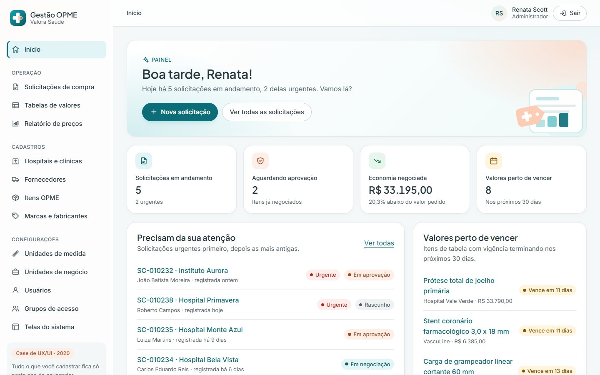

</div>

> **Este é um case de portfólio.** O projeto nasceu em 2020, numa empresa onde trabalhei,
> e foi recriado aqui para mostrar o processo e o resultado. Para preservar a empresa e o
> cliente, a interface usa a operadora fictícia **Valora Saúde**. Hospitais, fornecedores,
> fabricantes, pacientes, CNPJs, códigos TUSS e Anvisa e valores são todos de exemplo, e
> nada do que você digita sai do seu navegador.

---

## Sumário

- [O case](#o-case)
  - [Contexto e problema](#contexto-e-problema)
  - [Objetivo](#objetivo)
  - [Decisões de design](#decisões-de-design)
  - [A marca fictícia](#a-marca-fictícia)
  - [Revisitando o case](#revisitando-o-case)
- [A jornada, tela a tela](#a-jornada-tela-a-tela)
- [O que funciona no protótipo](#o-que-funciona-no-protótipo)
- [Acessibilidade](#acessibilidade)
- [Tecnologias e arquitetura](#tecnologias-e-arquitetura)
- [Como rodar localmente](#como-rodar-localmente)
- [Publicação no GitHub Pages](#publicação-no-github-pages)
- [Segurança e privacidade](#segurança-e-privacidade)
- [Limitações](#limitações)
- [Próximos passos](#próximos-passos)
- [Histórico](#histórico)
- [Autor](#autor)

---

## O case

### Contexto e problema

OPME (órteses, próteses e materiais especiais) é uma das contas mais caras de uma
operadora de saúde. Uma prótese de quadril ou um marca-passo custam dezenas de milhares de
reais, e o mesmo item pode ter preços muito diferentes de um hospital para outro.

Antes do sistema, a compra desses materiais dependia de planilhas, e-mails e telefonemas:

- o hospital pedia os materiais de uma cirurgia, muitas vezes sem valor de referência;
- a operadora não tinha num lugar só as tabelas negociadas com cada hospital e fornecedor;
- propostas e contrapropostas se perdiam em conversas, sem registro de quem aceitou o quê;
- a aprovação de valores altos não tinha uma alçada clara.

### Objetivo

Criar um sistema interno para a equipe de OPME da operadora, onde:

1. o pedido do hospital vira uma **solicitação de compra** com paciente, médico, procedimento e itens;
2. cada item já aparece com o **valor tabelado** e com o **menor valor entre fornecedores** como referência;
3. a **negociação** fica registrada proposta a proposta, até o valor acordado;
4. a **aprovação** respeita a alçada da diretoria e gera um **mapa consolidado** com a economia;
5. os cadastros de base (hospitais, fornecedores, itens, fabricantes, usuários e permissões) ficam no mesmo lugar.

### Decisões de design

| Decisão | Por quê |
| --- | --- |
| Solicitação em **5 etapas** com indicador de progresso | O processo real é longo e passa por pessoas diferentes. Dividir em etapas mostra onde cada pedido está e o que falta. |
| **Valor tabelado e referência de mercado** ao lado do pedido do hospital | Quem negocia precisa de um número para comparar. Ver o menor valor entre fornecedores na mesma linha encurta a conversa. |
| Negociação como **histórico de propostas**, não um campo de valor | O valor final só faz sentido com o caminho até ele. Cada proposta, contraproposta e aceite fica com data, origem e responsável. |
| **Aceitar valores tabelados** de uma vez | A maior parte dos itens já tem preço combinado. O trabalho manual fica só para o que realmente precisa ser negociado. |
| **Alçada da diretoria** acima de R$ 30 mil | Valores altos pedem uma segunda assinatura. O sistema avisa e só libera a aprovação depois do aval registrado. |
| **Aprovação por item**, com motivo obrigatório para reprovar | Uma solicitação pode ter itens aprovados e outros não. O hospital precisa saber o porquê. |
| Bloqueio de item com **registro na Anvisa vencido** | Evita comprar material irregular. O aviso aparece no cadastro do item e na inclusão na solicitação. |
| **Exclusão protegida** nos cadastros | Não dá para excluir um fabricante ligado a itens ou um grupo com usuários. O sistema explica e sugere inativar. |
| Um **mesmo padrão** para todas as consultas e cadastros | Filtros, tabela com ordenação, paginação, exportação e formulário com seções funcionam igual em todas as telas. Aprende-se uma vez. |

### A marca fictícia

**Valora Saúde** é uma operadora inventada para o case. O nome vem de *valorar*, dar o
valor justo a algo, que é o coração do trabalho com OPME.

O símbolo junta uma **cruz de saúde** com uma **etiqueta de preço** no braço direito:
cuidado e valor justo na mesma forma. Ele funciona como favicon e aparece no menu, no topo e
no login.

### Revisitando o case

Em 2026 o protótipo foi revisitado. A versão original tinha cerca de 27 telas feitas com
Bootstrap e jQuery, a maioria só visual, com dados fixos e a marca do cliente. Agora:

- **Tudo funciona de ponta a ponta**: cadastrar, editar, filtrar, negociar, aprovar, suspender valores e exportar.
- **Um design system próprio**, claro e suave, com login escuro, sem framework de CSS.
- **Acessibilidade revisada para a WCAG 2.2 AA**, verificada com axe em todas as telas.
- **Textos mais próximos e humanos**, com mensagens de erro que explicam como corrigir.
- **Zero dependências de runtime**: saíram Bootstrap, jQuery, Popper, nice-select, datetimepicker, jquery.mask, Font Awesome e as fontes da marca original.
- **Dados fictícios** gerados de forma determinística, com CNPJs válidos e datas relativas a hoje.

---

## A jornada, tela a tela

| Login | Painel inicial |
| --- | --- |
| 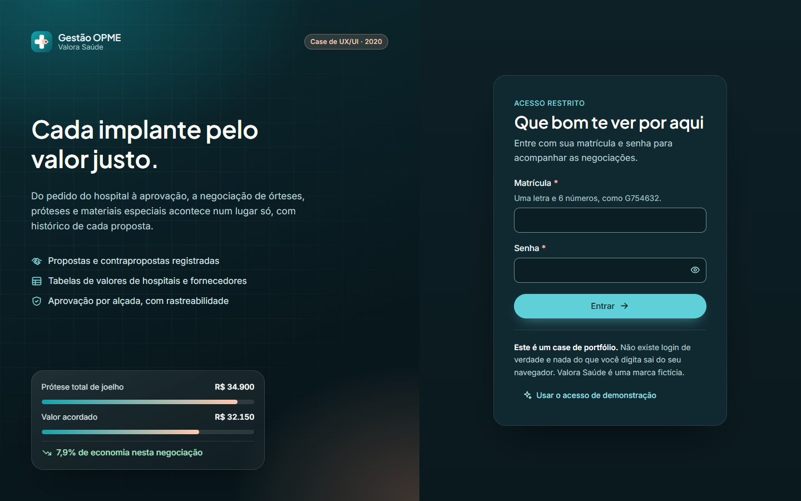 |  |

| Negociação | Registro de proposta |
| --- | --- |
| 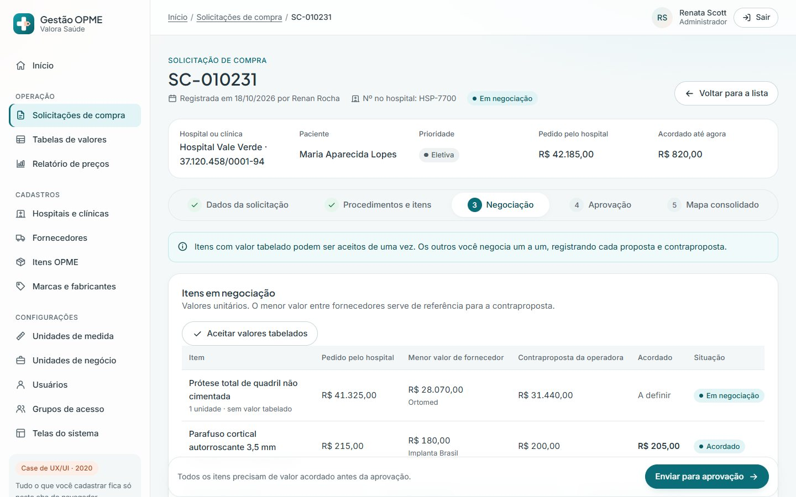 | 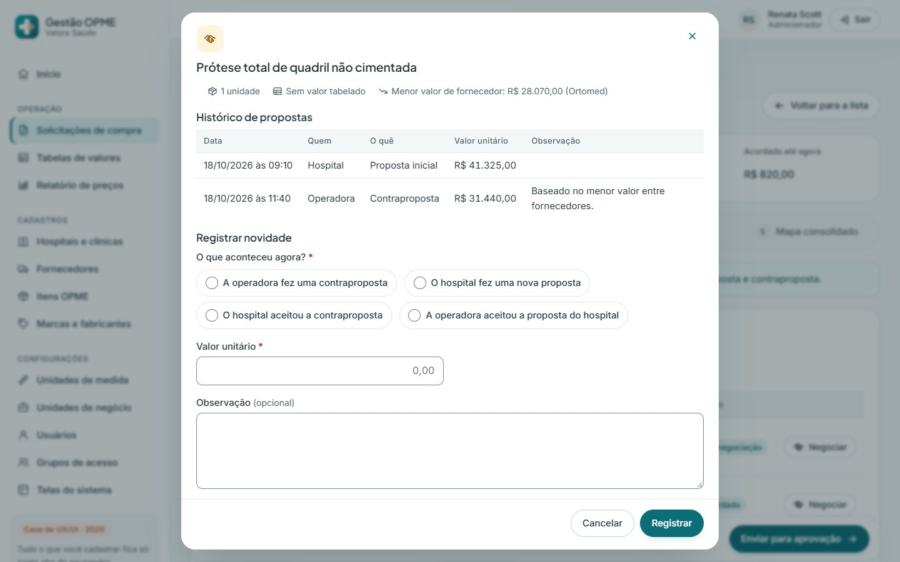 |

| Aprovação | Mapa consolidado |
| --- | --- |
| 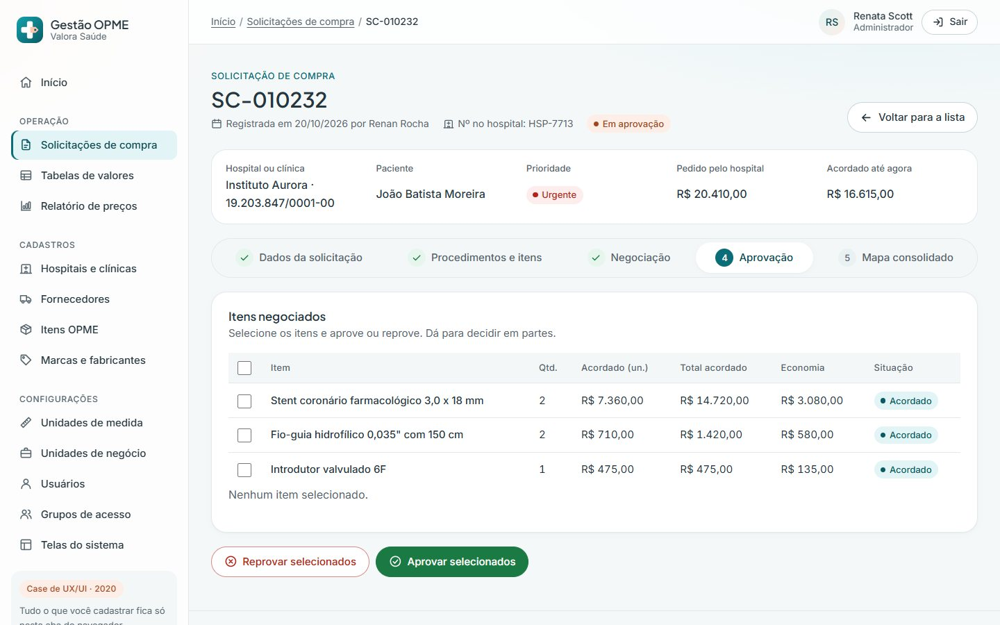 | 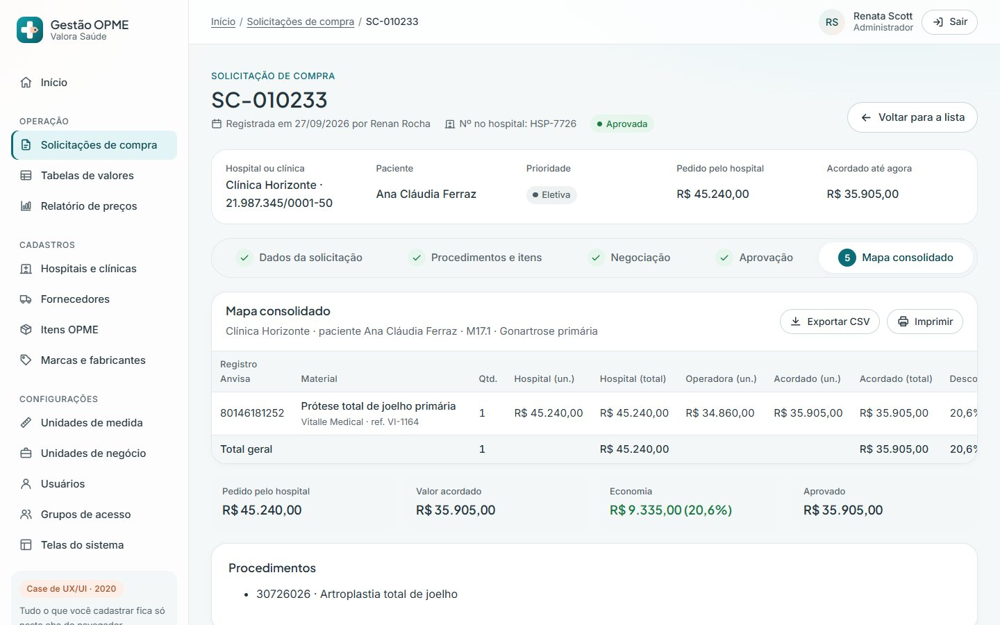 |

| Tabela de valores | Relatório de preços |
| --- | --- |
| 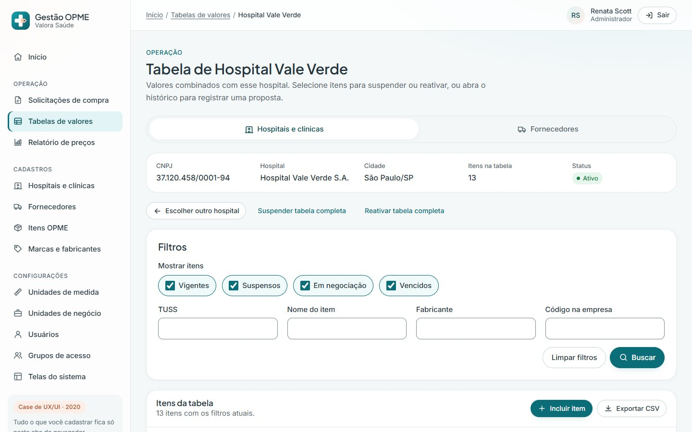 | 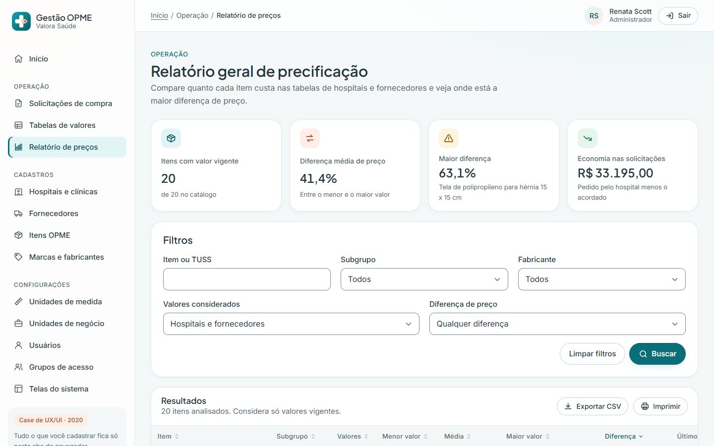 |

| Cadastro com erros | Permissões do grupo |
| --- | --- |
| 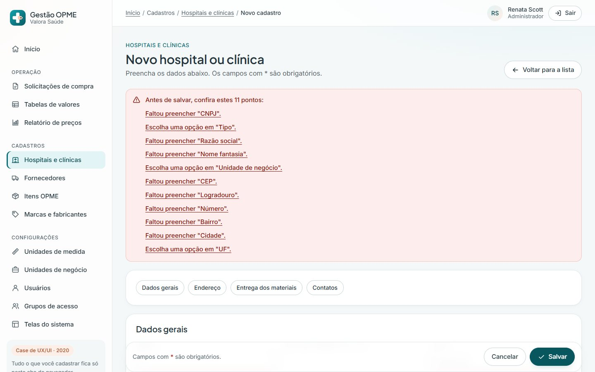 | 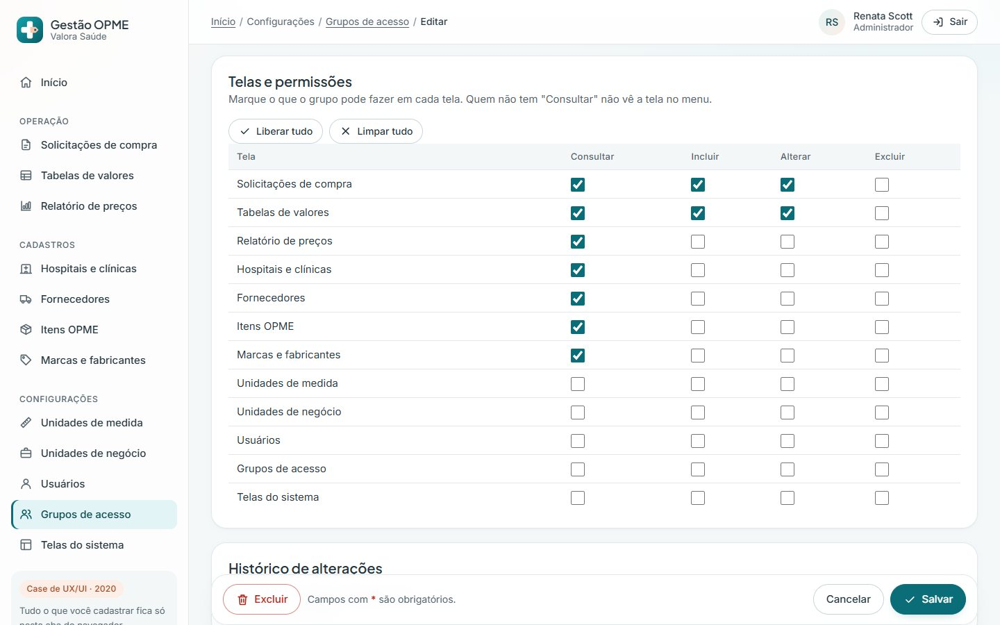 |

| Celular | Menu no celular |
| --- | --- |
| 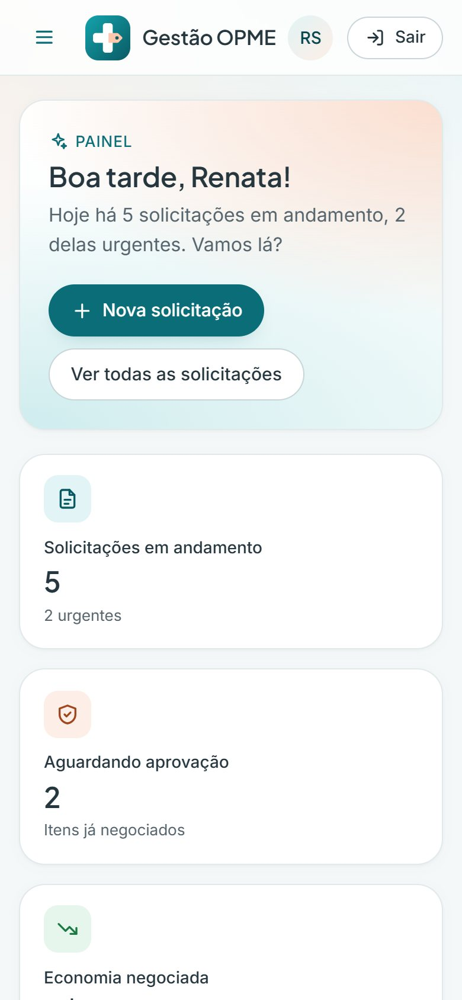 | 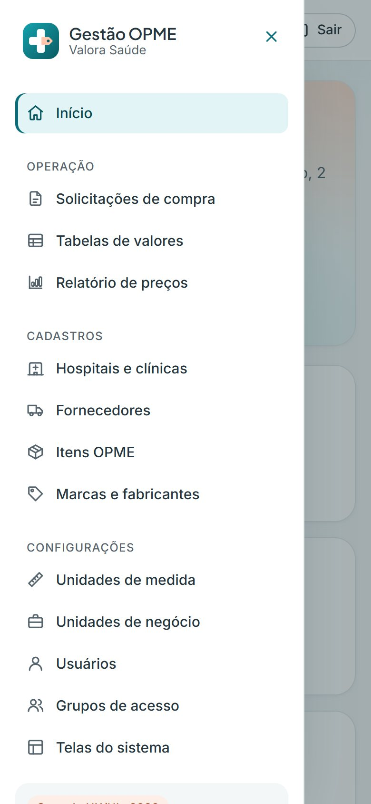 |

| Tela | Arquivo | O que faz |
| --- | --- | --- |
| Login | `login.html` | Matrícula e senha, com validação e botão de acesso de demonstração. Não há autenticação real. |
| Painel | `inicio.html` | Indicadores (em andamento, aguardando aprovação, economia, valores perto de vencer), solicitações que precisam de atenção, atalhos e o fluxo explicado. |
| Solicitações | `solicitacoes.html` | Consulta com filtros por número, paciente, hospital, status, prioridade e período. |
| Solicitação | `solicitacao.html` | As 5 etapas: dados, procedimentos e itens, negociação, aprovação e mapa consolidado. |
| Tabelas de valores | `tabelas.html` | Escolha de hospital ou fornecedor, filtros por situação, suspender e reativar em lote, incluir item e histórico de propostas. |
| Relatório | `relatorio.html` | Menor, média e maior valor de cada item, diferença de preço e último valor acordado. |
| Consultas | `consulta.html?tipo=...` | Uma tela para os 9 cadastros: hospitais, fornecedores, itens, marcas, unidades de medida e de negócio, usuários, grupos e telas. |
| Cadastros | `cadastro.html?tipo=...&id=...` | Inclusão e edição com seções, endereço, contatos, listas de marcação, permissões, histórico e exclusão protegida. |

---

## O que funciona no protótipo

**Solicitação de compra**
- Validações de negócio: cirurgia não pode ser antes da solicitação, reanálise precisa apontar para uma solicitação existente, carteirinha com 13 números, CRM e telefone.
- Inclusão de itens com valor tabelado automático. Itens sem tabela pedem o valor do hospital. Itens repetidos ou com Anvisa vencida são barrados.
- Negociação com quatro movimentos: contraproposta da operadora, nova proposta do hospital e aceite de cada lado. A contraproposta precisa ser menor que o último pedido.
- Envio para aprovação só com todos os itens acordados. Aprovação parcial, reprovação com motivo e reabertura para negociação.
- Aviso de alterações não salvas ao trocar de etapa ou sair da página.

**Tabelas de valores**
- Situações vigente, suspenso, em negociação e vencido (calculado pela data de fim).
- Seleção em lote, suspender ou reativar a tabela inteira, inclusão de item com vigência validada.
- Registro de proposta e aceite, que atualiza o valor e a vigência.

**Cadastros**
- Máscaras de CNPJ, CEP, telefone e valores em reais, e validação dos dígitos do CNPJ.
- Bloqueio de duplicidade (CNPJ, matrícula, sigla, e-mail) e aviso de nomes parecidos para fabricantes.
- Endereço de entrega que aparece só quando é diferente, lista de contatos, matriz de permissões em que "Alterar" marca "Consultar" junto.
- Histórico de alterações com quem e quando, e exclusão bloqueada para registros em uso.

**Em todas as listas**
- Filtros lembrados durante a sessão, ordenação por coluna, paginação, exportação para CSV e versão para impressão.
- O registro recém-salvo aparece destacado, já na página certa da lista.
- **Restaurar dados de exemplo**, no rodapé do menu, volta tudo ao estado original.

---

## Acessibilidade

O protótipo foi revisado para a **WCAG 2.2 nível AA** e verificado com o
[axe-core](https://github.com/dequelabs/axe-core) em todas as telas e estados (erros,
diálogos, menu aberto), no desktop e no celular, sem violações.

- **Estrutura**: landmarks, link para pular ao conteúdo, títulos em ordem e trilha de navegação com `aria-current`.
- **Formulários**: rótulo visível em todos os campos, dicas ligadas por `aria-describedby`, erro no próprio campo e num resumo no topo com links que levam ao campo.
- **Validação que não atrapalha**: depois da primeira tentativa, o erro some enquanto a pessoa corrige. Nada muda de lugar no momento em que ela sai do campo, para o clique no botão seguinte não cair no lugar errado.
- **Tabelas**: legenda, cabeçalhos de linha e coluna, ordenação com `aria-sort` e anúncio, área rolável com foco de teclado e paginação nomeada.
- **Diálogos** com `<dialog>` nativo: prendem o foco, fecham com Esc e devolvem o foco a quem abriu.
- **Menu no celular** como gaveta modal: o conteúdo atrás fica `inert`, Esc fecha e o foco volta ao botão.
- **Anúncios** para leitores de tela em ações sem mudança de página: "3 itens selecionados", "Valor acordado", "Ordenado por item".
- **Mudança de etapa** leva o foco ao título da etapa e atualiza o título da aba ("Etapa 3 de 5: Negociação").
- **Contraste** de pelo menos 4,5:1 em texto e 3:1 em bordas de campos, alvos de toque de 44 px, suporte a movimento reduzido e ao alto contraste do Windows.

---

## Tecnologias e arquitetura

- **HTML, CSS e JavaScript puros**, sem build, sem framework e sem bibliotecas de runtime.
- **Montserrat e Open Sans** via Google Fonts.
- **Ícones** num sprite SVG próprio (`img/icons.svg`).

```text
.
├── index.html            Redireciona para o login
├── login.html            Login (escuro)
├── inicio.html           Painel
├── solicitacoes.html     Lista de solicitações
├── solicitacao.html      Solicitação em 5 etapas
├── tabelas.html          Tabelas de valores
├── relatorio.html        Relatório de preços
├── consulta.html         Consulta genérica dos cadastros (?tipo=...)
├── cadastro.html         Cadastro genérico (?tipo=...&id=...)
├── css/app.css           Design system (tokens, componentes, login, impressão)
├── js/common.js          Estrutura, validação, máscaras, diálogos, tabela, CSV
├── js/data.js            Dados de exemplo e esquemas dos cadastros
├── js/<página>.js        Comportamento de cada página
├── img/                  Símbolo, sprite de ícones e ilustração
└── docs/screenshots/     Capturas usadas neste README
```

**Cadastros guiados por esquema.** Os 9 cadastros usam as mesmas duas páginas. Cada um é
descrito em `js/data.js`: seções, campos (tipo, máscara, regras, campos condicionais),
filtros, colunas, regras de duplicidade e quando a exclusão é bloqueada. Para criar um
cadastro novo, basta acrescentar um esquema.

**Validação declarativa.** As regras vêm do próprio HTML (`required`,
`data-rules="cnpj email"`, `data-mask="cep"`), e cada tela só adiciona as regras de negócio.

**Dados.** O "banco" é um objeto JSON no `sessionStorage` (chave `opme:db`), criado a partir
de um gerador determinístico na primeira visita. As datas são relativas ao dia de hoje, para
que vencimentos e prazos façam sentido sempre que alguém abrir o protótipo.

---

## Como rodar localmente

O projeto é estático: basta servir a pasta com qualquer servidor HTTP. Prefira um servidor
ao `file://`, porque a CSP e o sprite de ícones se comportam de forma diferente com
arquivos locais.

```bash
git clone https://github.com/fernandopinhel/OPME.git
cd OPME

# Opção 1: Python
python3 -m http.server 8080

# Opção 2: Node
npx serve .
```

Depois, acesse <http://localhost:8080> e clique em **Usar o acesso de demonstração**.

Para validar o HTML:

```bash
npx htmlhint@1 "*.html"
```

---

## Publicação no GitHub Pages

O site é publicado direto da branch `master` (**Settings → Pages → Deploy from a branch**,
pasta `/`). A cada merge na `master`, o GitHub atualiza o site em cerca de um minuto. O
arquivo `.nojekyll` faz o GitHub servir os arquivos como estão, sem processar com Jekyll.

Endereço: <https://fernandopinhel.github.io/OPME/>

---

## Segurança e privacidade

- **Nenhum dado sai do navegador.** Não há back-end. Sessão e cadastros ficam no `sessionStorage` e somem ao fechar a aba.
- **Content Security Policy** em todas as páginas: `script-src 'self'`, `style-src` sem `'unsafe-inline'`, `object-src 'none'`, `base-uri 'self'` e `form-action 'self'`. Só o Google Fonts é liberado como origem externa.
- **Sem JavaScript nem CSS inline.** Nenhum `<script>` inline, handler `on*=` ou atributo `style=` no HTML; a CSP bloquearia se houvesse.
- **Sem injeção de HTML.** Os elementos são montados com `createElement` e `textContent`, nunca com `innerHTML`.
- **CSV seguro**: valores que começam com `=`, `+`, `-` ou `@` são neutralizados para não virarem fórmula no Excel.
- **Referrer Policy** `strict-origin-when-cross-origin` e `noindex` para buscadores.
- **Dependabot** monitora as GitHub Actions.

O GitHub Pages não permite definir cabeçalhos HTTP, por isso a CSP vai em `<meta>` e
`frame-ancestors` não se aplica. Veja também o [SECURITY.md](SECURITY.md).

---

## Limitações

- É um **protótipo**: não há back-end, autenticação real nem integração com hospitais ou fornecedores.
- Os dados vivem só na aba do navegador. Outra aba ou outro navegador começa do zero.
- As permissões dos grupos são cadastradas, mas não restringem o que a usuária de demonstração vê.
- O CEP não preenche o endereço sozinho, para não enviar dados a um serviço externo.
- A marca Valora Saúde e todos os dados são fictícios. O repositório **não tem licença de código aberto**.

---

## Próximos passos

- [ ] CI com HTMLHint, bloqueio de código inline, testes de fluxo (Playwright) e auditoria de acessibilidade (axe).
- [ ] Aplicar as permissões do grupo ao menu e às ações de cada tela.
- [ ] Anexar documentos à solicitação (laudo, nota fiscal, etiquetas de rastreabilidade).
- [ ] Etapa de entrega e faturamento, com conferência do material usado na cirurgia.
- [ ] Mais relatórios: ranking de fornecedores, economia por negociação e produtividade por analista.

---

## Histórico

### 2026-10: Case revisitado

- Operadora fictícia Valora Saúde, com símbolo que une cruz de saúde e etiqueta de preço, no lugar da marca do cliente original.
- Reescrita completa em HTML, CSS e JavaScript puros, com visual claro e suave e login escuro.
- Fluxos funcionais de ponta a ponta: solicitação em 5 etapas, negociação, aprovação por alçada, tabelas de valores, relatório e 9 cadastros.
- Acessibilidade revisada para a WCAG 2.2 AA, verificada com axe.
- Saíram Bootstrap, jQuery, Popper, plugins, Font Awesome, as fontes e os ícones da marca original e cerca de 15 MB de arquivos.
- Publicação no GitHub Pages, Dependabot e `SECURITY.md`.

### 2020-04 a 2023-08: Versão original

Protótipo navegável criado na empresa onde o projeto nasceu, com Bootstrap e jQuery.

---

## Autor

**Fernando Pinhel**, Fullstack Designer (UX/UI, Design Systems e Front-end)
[fernandopinhel.com.br](https://fernandopinhel.com.br) · [GitHub](https://github.com/fernandopinhel)
